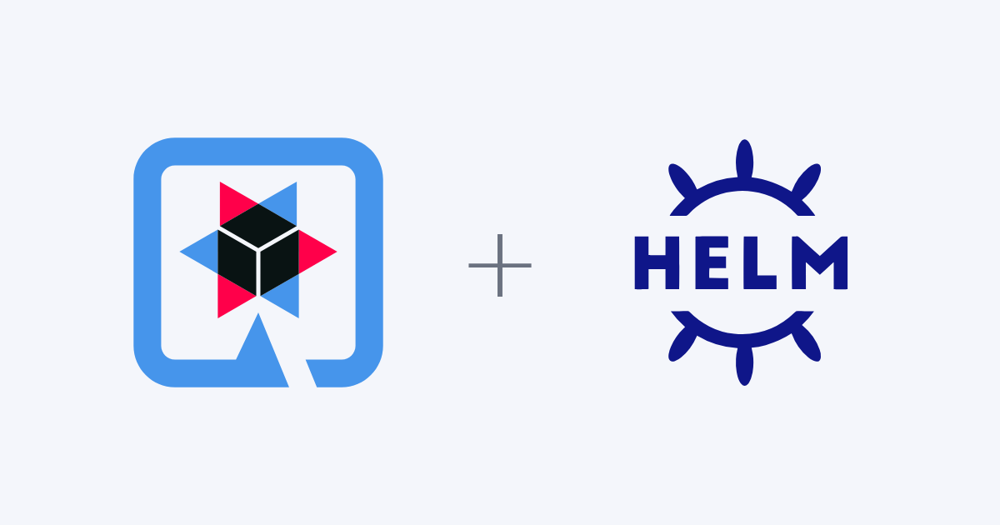
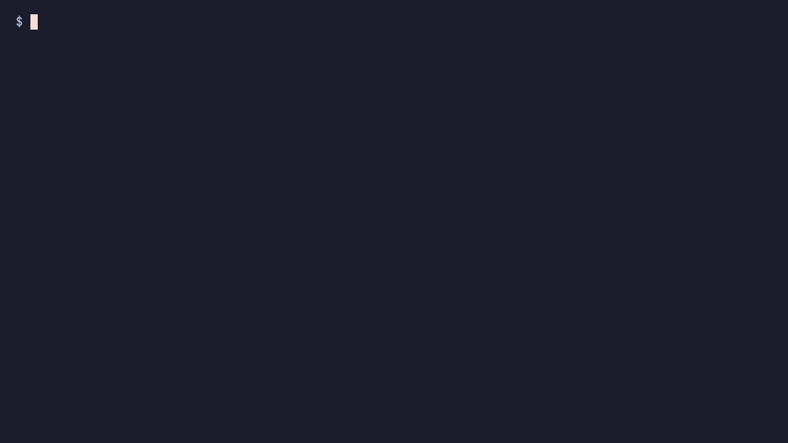

Your service is done, the tests pass and the image is ready. Then someone
asks: "what about the Helm chart?". For a lot of people, that is when the hunt
begins for a chart from another project to copy, paste and adapt.

The [Quarkus Helm](https://github.com/quarkiverse/quarkus-helm) extension
solves exactly that: it generates the chart for your application during the
build. In this post we will generate the chart for an API that looks like the
ones you run in production, with a database, health checks and an Ingress, and
install it on a local cluster, without writing a single template.

## Helm in two minutes

To run an application on Kubernetes you describe it in YAML files called
manifests: a Deployment for the pods, a Service to reach them, an Ingress to
expose them. The manifests are almost the same in every environment. What
changes is a handful of details, such as the number of replicas, the image
tag or the database address.

[Helm](https://helm.sh/) is the package manager that handles this. It works
with three ideas:

- **Chart:** the package. It holds the manifests as templates, with
  placeholders where the details go.
- **Values:** the details. A `values.yaml` file holds the defaults, and
  whoever installs the chart can override any of them.
- **Release:** one installation of the chart in a cluster. You can install,
  upgrade, roll back and uninstall it as a unit.

A template is a manifest with placeholders:

```yaml
# templates/deployment.yaml
spec:
  replicas: {{ .Values.app.replicas }}
```

The default comes from `values.yaml`:

```yaml
app:
  replicas: 2
```

And each installation can change it:

```bash
helm install orders ./my-chart --set app.replicas=4
```

That gives you one chart for development, staging and production.

The catch is who writes the chart. Done by hand, every template has to be
kept in sync with the application. Each new port, environment variable or
health check is one more place to update, and nothing warns you when the
chart falls behind the code. This is the work the extension takes over.

## What the extension does

Quarkus already knows how to generate Kubernetes manifests from your
`application.properties`, through the `quarkus-kubernetes` extension. Quarkus
Helm takes those manifests and turns them into a chart:

- it generates `Chart.yaml` with the project name and version;
- it replaces fixed values with references to `values.yaml` (replicas, image,
  ports, environment variables, probes, Ingress host);
- it generates `values.yaml` with the defaults;
- it generates `values.schema.json`, which Helm uses to validate the values.

All of this happens during `package`. The source of truth is still
`application.properties`.

## The scenario: an orders API

A "hello world" does not show what the extension does for you. We will use
`orders-api`, a service with the concerns of a real one:

- it connects to PostgreSQL, and the address changes in each environment;
- it exposes health checks so Kubernetes knows when to restart the pod;
- it is published through an Ingress, with a different host per environment;
- it has a memory limit that the SRE team wants to be able to tune;
- it must never run with fewer than two replicas.

In a hand-written chart, that means a Deployment with probes, a Service, an
Ingress and a `values.yaml` to tie it all together. Here it takes about ten
lines of configuration.

The full code is at
[matheusandre1/example-01-stop-writing-helm-charts](https://github.com/matheusandre1/example-01-stop-writing-helm-charts).

You will need JDK 21, Docker and the
[Helm CLI](https://helm.sh/docs/intro/install/). For the cluster part, also
[minikube](https://minikube.sigs.k8s.io/) and `kubectl`.

### 1. Create the project

```bash
mvn io.quarkus.platform:quarkus-maven-plugin:3.40.1.1:create \
    -DprojectGroupId=org.acme \
    -DprojectArtifactId=orders-api \
    -Dextensions="rest-jackson,hibernate-orm-panache,jdbc-postgresql,smallrye-health,helm,container-image-docker"
cd orders-api
```

If the project already exists, just add the extension:

```bash
./mvnw quarkus:add-extension -Dextensions="helm"
```

The `quarkus-kubernetes` extension comes along transitively.

The application itself is small: one entity and one REST endpoint.

```java
@Entity
@Table(name = "orders")
public class Order extends PanacheEntity {
    public String customer;
    public String product;
    public int quantity;
}
```

```java
@Path("/orders")
public class OrderResource {

    @GET
    public List<Order> list() {
        return Order.listAll();
    }

    @POST
    @Transactional
    public Response create(Order order) {
        order.persist();
        return Response.status(Response.Status.CREATED).entity(order).build();
    }
}
```

### 2. Describe the deployment in `application.properties`

```properties
# Chart metadata
quarkus.helm.description=Orders API for the store

# Database: configurable at install time
%prod.quarkus.datasource.jdbc.url=${POSTGRESQL_URL:jdbc:postgresql://postgres:5432/orders}
%prod.quarkus.datasource.username=${POSTGRESQL_USERNAME:orders}
%prod.quarkus.datasource.password=${POSTGRESQL_PASSWORD:orders}

# Create the tables on startup (good enough for this example)
quarkus.hibernate-orm.schema-management.strategy=update

# Kubernetes
quarkus.kubernetes.replicas=2
quarkus.kubernetes.ingress.expose=true
quarkus.kubernetes.ingress.host=orders.example.com
quarkus.kubernetes.resources.requests.memory=256Mi
quarkus.kubernetes.resources.limits.memory=512Mi

# Expose the memory limit as a chart value
quarkus.helm.values.memoryLimit.paths=(kind == Deployment).spec.template.spec.containers.resources.limits.memory

# Nobody installs with fewer than 2 replicas
quarkus.helm.values-schema.properties.replicas.type=integer
quarkus.helm.values-schema.properties.replicas.minimum=2
```

Four things deserve attention here:

- **`${POSTGRESQL_URL:...}`** is the Quarkus `${NAME:default-value}` pattern.
  The extension detects it and turns each property into an environment
  variable that the chart can configure.
- **`%prod.`** limits the database configuration to the production profile.
  In development and in tests, Quarkus starts a PostgreSQL on its own with
  Dev Services. The chart is generated from the production profile, so
  nothing changes in it.
- **`quarkus.helm.values.memoryLimit.paths`** maps a field the extension does
  not expose on its own. The expression points to the field inside the
  Deployment, and it becomes the `app.memoryLimit` value.
- **`values-schema`** creates a validation rule. Declare the `type` together
  with the `minimum`: without it, the schema marks `replicas` as a string and
  the chart stops passing `helm lint`.

### 3. Generate the chart

```bash
./mvnw clean package
```

The chart shows up in `target/helm/kubernetes/orders-api/`:

```text
Chart.yaml
README.md
values.yaml
values.schema.json
templates/
├── NOTES.txt
├── deployment.yaml
├── ingress.yaml
└── service.yaml
```

### 4. Look at what was generated

`values.yaml` gathers everything that changes between environments:

```yaml
app:
  envs:
    POSTGRESQL_PASSWORD: orders
    POSTGRESQL_URL: jdbc:postgresql://postgres:5432/orders
    POSTGRESQL_USERNAME: orders
  host: orders.example.com
  image: docker.io/<your-user>/orders-api:1.0.0-SNAPSHOT
  livenessProbe:
    failureThreshold: 3
    httpGet:
      path: /q/health/live
      scheme: HTTP
    initialDelaySeconds: 5
    periodSeconds: 10
    successThreshold: 1
    timeoutSeconds: 10
  memoryLimit: 512Mi
  ports:
    http: 8080
  readinessProbe:
    # same structure, at /q/health/ready
  replicas: 2
  startupProbe:
    # same structure, at /q/health/started
```

The probes were not in `application.properties`. They showed up because the
project has the `smallrye-health` extension: Quarkus adds the probes to the
Deployment and Quarkus Helm carries them into `values.yaml`.

`templates/deployment.yaml` already references those values:

```yaml
spec:
  replicas: {{ .Values.app.replicas }}
  ...
        - env:
            - name: POSTGRESQL_URL
              value: {{ .Values.app.envs.POSTGRESQL_URL | quote }}
          image: {{ .Values.app.image }}
          livenessProbe:
            failureThreshold: {{ .Values.app.livenessProbe.failureThreshold }}
            httpGet:
              path: {{ .Values.app.livenessProbe.httpGet.path }}
              port: {{ .Values.app.ports.http }}
          resources:
            limits:
              memory: {{ .Values.app.memoryLimit }}
            requests:
              memory: 256Mi
```

`requests.memory` stays fixed at `256Mi`, because we did not ask for it to be
mapped. Only what the extension maps on its own, or what you declare, becomes
a chart value.

And `templates/ingress.yaml` uses the host:

```yaml
spec:
  rules:
    - host: {{ .Values.app.host }}
```

You did not write any of those double curly braces.

### 5. Test without a cluster

You can check the chart before you have a cluster. `helm lint` validates the
structure and `helm template` shows the final manifests.

```bash
cd target/helm/kubernetes

helm lint orders-api
```

Now simulate a production install, changing replicas, memory and host:

```bash
helm template orders orders-api \
    --set app.replicas=4 \
    --set app.memoryLimit=1Gi \
    --set app.host=orders.mycompany.com
```

The rendered manifests come out with `replicas: 4`, a `1Gi` limit and the new
host in the Ingress. Same image, no new build.

What about the replicas rule? Try rendering with just one:

```bash
helm template orders orders-api --set app.replicas=1
```

Helm refuses before anything reaches the cluster:



## Installing on a local cluster

With minikube you can test the full cycle without a registry. The trick is to
build the image straight into minikube's Docker daemon:

```bash
minikube start
eval $(minikube docker-env)

./mvnw clean package \
    -Dquarkus.container-image.build=true \
    -Dquarkus.kubernetes.image-pull-policy=IfNotPresent
```

`image-pull-policy=IfNotPresent` makes Kubernetes use the local image. With
the default (`Always`), it would try to pull the image from a registry where
it does not exist.

The API needs a database. For the test, a throwaway PostgreSQL is enough:

```yaml
# k8s/postgres.yaml
apiVersion: apps/v1
kind: Deployment
metadata:
  name: postgres
spec:
  replicas: 1
  selector:
    matchLabels:
      app: postgres
  template:
    metadata:
      labels:
        app: postgres
    spec:
      containers:
        - name: postgres
          image: postgres:17
          env:
            - name: POSTGRES_DB
              value: orders
            - name: POSTGRES_USER
              value: orders
            - name: POSTGRES_PASSWORD
              value: orders
          ports:
            - containerPort: 5432
---
apiVersion: v1
kind: Service
metadata:
  name: postgres
spec:
  selector:
    app: postgres
  ports:
    - port: 5432
```

```bash
kubectl apply -f k8s/postgres.yaml
kubectl rollout status deployment/postgres
```

Wait for the database to be ready before installing the API: it creates its
tables on startup and restarts if it cannot connect.

Now it is plain Helm:

```bash
helm install orders target/helm/kubernetes/orders-api
kubectl rollout status deployment/orders-api
```

With the pods up, call the API:

```bash
kubectl port-forward svc/orders-api 8080:80

curl -X POST localhost:8080/orders \
    -H 'Content-Type: application/json' \
    -d '{"customer":"Ana","product":"Keyboard","quantity":2}'

curl localhost:8080/orders
```

```json
[{"id":1,"customer":"Ana","product":"Keyboard","quantity":2}]
```

Scaling does not need a new build. Just change the value:

```bash
helm upgrade orders target/helm/kubernetes/orders-api \
    --reuse-values --set app.replicas=3
```


And to remove everything:

```bash
helm uninstall orders
kubectl delete -f k8s/postgres.yaml
```

### What about a real cluster?

The chart is the same. Only the origin of the image changes: instead of
building into minikube's Docker daemon, push it to a registry the cluster can
reach.

```bash
./mvnw clean package \
    -Dquarkus.container-image.build=true \
    -Dquarkus.container-image.push=true \
    -Dquarkus.container-image.registry=<your registry> \
    -Dquarkus.container-image.group=<your namespace>
```

At install time, point to the environment's database:

```bash
helm install orders target/helm/kubernetes/orders-api \
    --set app.envs.POSTGRESQL_URL=jdbc:postgresql://db-prod:5432/orders
```

## What this changes day to day

- **For developers:** the chart stops being a separate artifact. Added an
  environment variable or a health check? The chart follows on the next
  build.
- **For DevOps:** the pipeline does not need a chart repository maintained on
  the side. The same build step delivers image and chart in the same version.
- **For SRE:** the operational knobs (replicas, memory, probe timings) live in
  `values`, and the schema blocks dangerous values before the deploy.
- **For platform teams:** every Quarkus service has a chart with the same
  structure (`app.image`, `app.replicas`, `app.envs`), which makes it easier
  to standardize pipelines.

## Before using it in production

- The extension is marked as **preview** in the documentation.
- Check the
  [compatibility table](https://github.com/quarkiverse/quarkus-helm#compatibility-with-quarkus)
  between the extension version and the Quarkus version.
- The database password is in `values.yaml` to keep the example short. In
  production, keep credentials in a Secret. The extension only maps plain
  environment variable values; Secrets and ConfigMaps do not go into
  `values.yaml`.
- The Ingress is created, but it only responds if the cluster has an Ingress
  controller.

## Next steps

The extension goes further: values profiles per environment, chart
dependencies (such as bringing PostgreSQL up together with the API) and
publishing to Helm repositories. We will explore those topics in the next
posts.